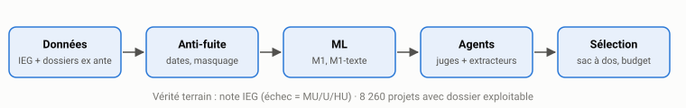
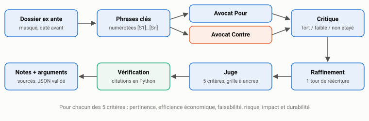
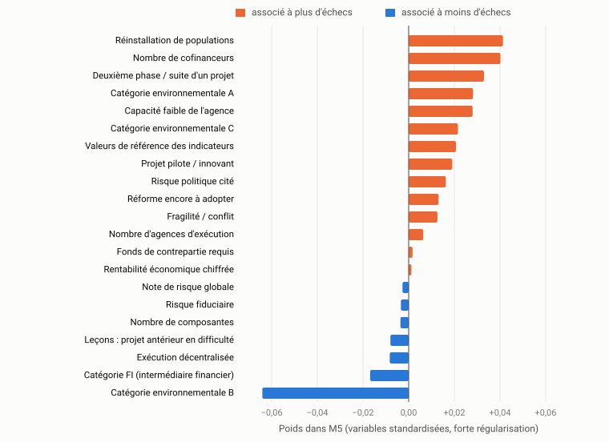
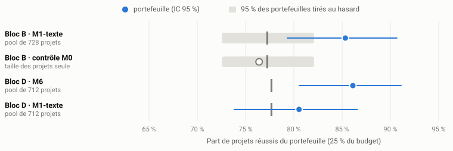
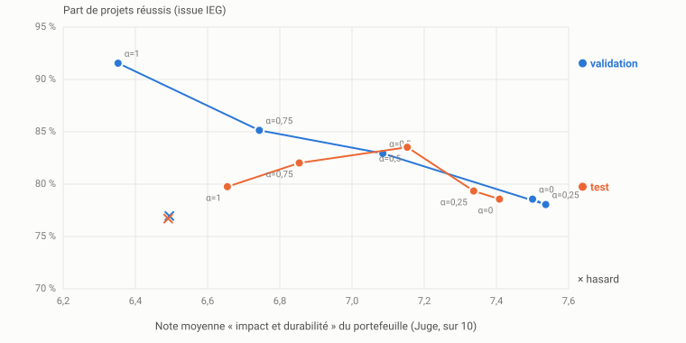
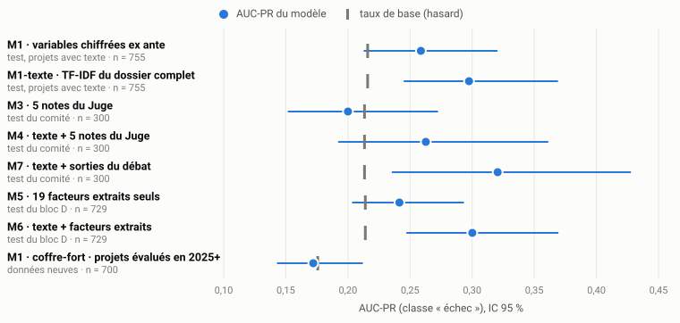
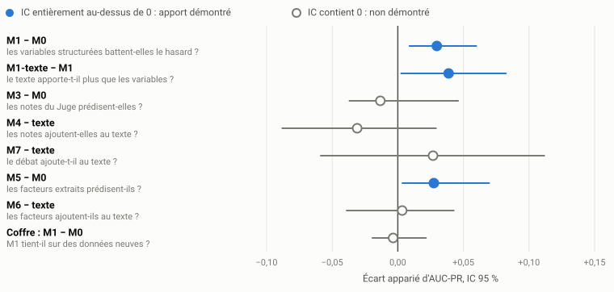

<!-- Fichier généré par `uv run python -m investagents.report.build` : ne pas modifier à la main (modifier src/investagents/report/rapport_template.md). -->
# InvestAgents : rapport final

*Projet de Machine Learning, sujet n°10 : « IA agentique pour la décision d'investissement
multicritère : évaluation et sélection de projets d'investissement ». Auteure : Aya (élève
ingénieure, data science / IA). Novembre 2026.*

*Ce document existe en trois versions identiques : `reports/rapport_final.md`, `docs/rapport.html`
(avec sommaire et glossaire cliquables) et `reports/rapport_final.pdf`. Les trois sont générées par
`uv run python -m investagents.report.build` à partir des fichiers de résultats du dépôt : aucun
chiffre n'est tapé à la main, et un test automatique vérifie que chaque chiffre correspond aux JSON
de résultats.*

<a id="sommaire"></a>
**Sommaire**

- [0. Résumé en une page](#s-0)
- [1. Contexte et question de recherche](#s-1)
- [2. Données](#s-2)
- [3. Anti-fuite](#s-3)
- [4. Protocole d'évaluation](#s-4)
- [5. Modèles ML](#s-5)
- [6. Agents juges (bloc C)](#s-6)
- [7. Agents extracteurs (bloc D)](#s-7)
- [8. Ce qui prédit vraiment l'échec : la part du pays (bloc E)](#s-8)
- [9. Décision multicritère et sélection](#s-9)
- [10. Métriques finales](#s-10)
- [11. Ce que les agents apportent / n'apportent pas](#s-11)
- [12. Limites](#s-12)
- [13. Reproductibilité](#s-13)
- [14. Attributions et usage de l'IA](#s-14)
- [15. Glossaire](#s-15)

<a id="s-0"></a>

## 0. Résumé en une page

> **En simple.** La Banque mondiale finance des milliers de projets ; 26,8 % des projets de notre
> recensement sont jugés en échec une fois terminés. Nous avons demandé à des agents d'IA de lire le dossier écrit *avant*
> le financement, de débattre du projet et de le noter, puis à un optimiseur de choisir quels
> projets financer avec un budget limité. Nous avons comparé tout cela à des modèles de machine
> learning classiques, sur des projets que personne n'avait regardés.

**La question.** Un comité d'agents d'IA qui lit les dossiers d'évaluation classe-t-il les projets
mieux qu'un modèle de machine learning classique ? Ses notes apportent-elles une information en
plus ?

**La méthode en 5 lignes.**

1. 8 260 vrais projets de la Banque mondiale, avec la note finale de l'<a id="ref-g-ieg"></a>[IEG](#g-ieg)
   (succès ou échec) comme vérité terrain.
2. Des règles anti-fuite strictes : seuls des documents datés *avant* l'approbation, noms masqués,
   <a id="ref-g-decoupage-temporel"></a>[découpage temporel](#g-decoupage-temporel) (on apprend sur le passé, on teste sur l'avenir).
3. Des modèles de référence : <a id="ref-g-gradient-boosting"></a>[gradient boosting](#g-gradient-boosting) sur des variables chiffrées, et
   <a id="ref-g-tf-idf"></a>[TF-IDF](#g-tf-idf) + <a id="ref-g-regression-logistique"></a>[régression logistique](#g-regression-logistique) sur le texte du dossier.
4. Deux familles d'<a id="ref-g-agent"></a>[agents](#g-agent) : des *juges* (débat Pour / Contre, critique, Juge sur 5
   critères) et des *extracteurs* (19 facteurs de risque factuels avec citations).
5. Un optimiseur (<a id="ref-g-sac-a-dos-cp-sat"></a>[sac à dos (CP-SAT)](#g-sac-a-dos-cp-sat)) qui choisit un portefeuille sous budget, testé contre
   des portefeuilles tirés au hasard.

**Les 5 résultats clés.**

1. **Le ML prédit l'échec, mais faiblement.** Le meilleur modèle (texte du dossier) obtient une
   <a id="ref-g-auc-pr"></a>[AUC-PR](#g-auc-pr) de 0,297 [0,245 ; 0,369] au test, contre 0,216 pour le hasard. Sur des données
   neuves (le <a id="ref-g-coffre-fort"></a>[coffre-fort](#g-coffre-fort)), le modèle à variables chiffrées tombe au niveau du hasard.
2. **Les agents juges n'ajoutent pas d'information prédictive.** Leurs 5 notes ne prédisent pas
   l'échec (0,200 [0,152 ; 0,272] contre un taux de base de 0,213).
3. **Les agents extracteurs produisent des facteurs lisibles et un peu prédictifs**
   (écart avec le hasard : +0,027 [0,003 ; 0,070]), mais n'apportent rien de plus que le texte complet
   (+0,003 [−0,039 ; 0,043]).
4. **Les agents justifient chaque décision avec des sources vérifiées** :
   99,8 % des citations retrouvées mot pour mot, 0 / 50 projet reconnu
   de mémoire.
5. **La sélection sous budget bat le hasard** au test (85,3 % de projets réussis contre
   77,2 %, p ≤ 0,001), grâce aux probabilités du ML et non à la taille des projets.

**Conclusion.** *Le ML prédit faiblement ; les agents justifient chaque décision avec des sources
vérifiées et extraient des facteurs de risque lisibles et prédictifs, mais n'ajoutent rien au texte
complet.* Le résultat principal est donc **négatif** pour la question de recherche, et
**positif** pour l'explication des décisions.

<a id="s-1"></a>

## 1. Contexte et question de recherche

> **En simple.** Choisir des projets à financer, c'est décider sous incertitude, avec plusieurs
> critères et un budget. Le sujet demande si des agents d'IA peuvent aider à *évaluer* les projets
> puis à les *sélectionner*. Nous avons pris de vrais projets dont on connaît la fin pour pouvoir
> vérifier.

**En technique.** Le sujet se décompose mot par mot :

| Mot de l'énoncé | Ce que nous avons construit |
| --- | --- |
| **IA agentique** | Un comité de <a id="ref-g-llm"></a>[LLM](#g-llm) à rôles (avocat Pour, avocat Contre, critique, Juge) orchestré par <a id="ref-g-langgraph"></a>[LangGraph](#g-langgraph), et des agents extracteurs de facteurs (sections 6 et 7). |
| **Décision d'investissement** | Choisir quels projets financer sous un budget fixé (section 9). |
| **Multicritère** | 5 critères inspirés des <a id="ref-g-criteres-ocde-cad"></a>[critères OCDE-CAD](#g-criteres-ocde-cad) : pertinence, efficience économique, faisabilité, risque, impact et durabilité ; combinés avec la probabilité de réussite par la <a id="ref-g-frontiere"></a>[frontière α](#g-frontiere) (section 9). |
| **Évaluation** | Prédire, avant l'approbation, si un projet sera en échec selon l'IEG (sections 5 à 8). |
| **Sélection** | Sac à dos exact sous budget avec plafond par pays, comparé au hasard (section 9). |

**Question de recherche.** Le comité d'agents classe-t-il les projets mieux qu'un gradient boosting
sur variables structurées ou qu'un modèle de texte simple ? Ses notes apportent-elles une
information en plus ? Vérité terrain : la note de résultat de l'IEG, binarisée en *succès*
(HS, S, MS) contre *échec* (MU, U, HU).



*Ce qu'il faut retenir : chaque étape alimente la suivante, et la vérité terrain (la note IEG)
n'est jamais montrée aux agents ni aux modèles avant l'évaluation.*

<a id="s-2"></a>

## 2. Données

> **En simple.** Pour chaque projet, nous avons la note finale de l'évaluateur indépendant de la
> Banque mondiale, et le dossier écrit avant le financement. Nous cherchons à prédire les échecs,
> qui sont minoritaires.

**En technique.**

- **Notes IEG** (licence CC BY 4.0) : note de résultat de chaque projet évalué. Cible
  `failure = 1` si MU, U ou HU (classe minoritaire).
- **Dossiers ex ante** (<a id="ref-g-pad"></a>[PAD](#g-pad) ou *Staff Appraisal Report*) : World Bank Documents & Reports API,
  en anglais, texte d'au moins 10 000 caractères, daté strictement avant l'approbation.
- **Recensement (phase 1)** : 8 260 projets notés ont un dossier exploitable
  (seuil go / no-go : 300), dont 2 210 en échec.
- **Variables structurées** (pour M1) : région, pratique et secteur, type d'instrument et
  d'accord, exercice d'approbation, montant à l'approbation (relevés IDA/IBRD, jamais le montant
  actuel), indicateurs pays (WDI). 11 541 projets notés
  avec ces variables : 9 004 pour l'entraînement, 1 243 pour la validation, 1 294
  pour le test.
- **Avec texte** (pour M1-texte) : 5 810 / 869 / 755.
- **Dérive** : le taux d'échec baisse avec le temps, 28 % à l'entraînement, 23 %
  en validation, 22 % au test, 17,6 % sur le coffre-fort. C'est un
  <a id="ref-g-decalage-de-domaine"></a>[décalage de domaine](#g-decalage-de-domaine), corrigé par recalibration sur la validation.

<a id="s-3"></a>

## 3. Anti-fuite

> **En simple.** Un modèle qui « voit l'avenir » a des scores trop beaux et inutiles. Nous avons
> donc interdit tout document écrit après l'approbation, masqué les noms des projets, et vérifié que
> le LLM ne reconnaissait pas les projets de mémoire.

**En technique.** La <a id="ref-g-fuite-de-donnees"></a>[fuite de données](#g-fuite-de-donnees) est la première menace d'un tel projet. Quatre barrières :

1. **Dates.** Seuls les documents datés *strictement avant* l'approbation (filtre unique
   `src/investagents/data/leakage.py`, couvert par des tests). Jamais d'ICR, d'ICRR ou de PPAR
   (rapports de fin de projet). La tolérance de 31 jours n'existe que comme test de sensibilité.
2. **Colonnes interdites.** Les variables IEG post-projet sont refusées par
   `assert_no_forbidden` (`src/investagents/ml/features.py`) : `quality_at_entry`,
   `bank_performance`, `quality_of_supervision`, `me_quality`, `final_closing_fy` et toute colonne
   `evaluation_*`. Un test échoue si l'une d'elles entre dans les variables.
3. **Masquage.** Noms et identifiants de projets masqués côté agents ; noms de pays et de lieux
   masqués (spaCy + listes GeoNames) dans le texte montré aux agents. Pas d'accès au web pour les
   agents. Le texte des documents est traité comme une donnée, jamais comme une instruction.
4. **<a id="ref-g-test-de-reconnaissance"></a>[Test de reconnaissance](#g-test-de-reconnaissance).** Sur 50 dossiers masqués, on
   demande au LLM s'il reconnaît le projet : 0 / 50 projet reconnu, 0 / 50
   note IEG proposée.

<a id="s-4"></a>

## 4. Protocole d'évaluation

> **En simple.** On règle les modèles sur une période, on les note une seule fois sur une période
> plus récente, et un dernier paquet de projets reste sous clé jusqu'à la fin. Chaque règle a été
> enregistrée dans git *avant* de voir les résultats : les identifiants de commits en sont la preuve.

**En technique.**

- **[Découpage temporel](#g-decoupage-temporel)** sur l'exercice d'approbation : entraînement
  ≤ 2007, validation 2008–2011, test 2012–2017.
- **Validation pour régler** : tous les hyperparamètres, l'objectif de sélection et les choix de
  codage sont faits sur la validation, souvent par <a id="ref-g-validation-croisee"></a>[validation croisée](#g-validation-croisee).
- **Test une seule fois** : chaque modèle est figé (fichier `*_frozen.json` commité), puis évalué
  une fois sur le test, avec <a id="ref-g-intervalle-de-confiance-bootstrap"></a>[IC bootstrap](#g-intervalle-de-confiance-bootstrap) à 95 % et
  <a id="ref-g-ecart-apparie"></a>[écarts appariés](#g-ecart-apparie).
- **Coffre-fort** : projets évalués par l'IEG en exercice ≥ 2025, ouverts une seule fois à la fin.

**Preuves dans l'historique git** (règle commitée → résultat commité) :

| Étape | Règle figée avant le résultat | Résultat |
| --- | --- | --- |
| Filtre anti-fuite | `7ac3f95` | — |
| Split temporel et coffre-fort | `ab4fd2d` | — |
| M1 et M1-texte (phase 2) | `c8974e6`, `9fbad94` | `cc0cac1` |
| Objectif de sélection | `eb73040` (choisi sur la validation) | `eb73040` (test une fois) |
| M1-texte du bloc B | `fe7a113` | `fe7a113` |
| M3 / M4 (notes du Juge) | `3e5f2de` | `024d6b5` |
| Coffre-fort | `ab9150e`, amendement `a572980` | `ead4cbe` |
| Grille des 19 facteurs | `ddd4cb1` | — |
| Pilote du bloc D | critères dans `d990604` | `2864354` |
| M5 / M6 | `3bf9e25` (codage), `106c3f0` (seuils), `a3ccb07` (réglage) | `43180e4` |
| Part du pays (bloc E) | `ef29775` (liste, modèle, règle de conclusion) | commit suivant |

Deux lignes ont la règle et le résultat dans le même commit (objectif, bloc B) : le script
enchaîne le choix sur la validation puis l'évaluation unique, sans retour en arrière possible.

<a id="s-5"></a>

## 5. Modèles ML

> **En simple.** M0 répond toujours « taux moyen d'échec » : c'est le plancher. M1 utilise des
> chiffres sur le projet et le pays. M1-texte lit les mots du dossier. Une petite correction finale
> rend leurs probabilités honnêtes.

**En technique.**

- **M0** : prédit le <a id="ref-g-taux-de-base"></a>[taux de base](#g-taux-de-base) pour tous les projets (AUC-PR = taux de base).
- **M1** : [gradient boosting](#g-gradient-boosting) (`HistGradientBoostingClassifier`) sur variables structurées ex
  ante (jeu `base+wdi`). AUC-PR 0,307 en validation ; au test,
  0,247 [0,216 ; 0,286] contre 0,217 pour M0 ; écart apparié +0,030 [0,009 ; 0,060] ;
  <a id="ref-g-test-de-permutation"></a>[test de permutation](#g-test-de-permutation) : p = 0,015. <a id="ref-g-auc-roc"></a>[AUC-ROC](#g-auc-roc) 0,567 [0,529 ; 0,603].
- **M1-texte** : [TF-IDF](#g-tf-idf) du dossier complet + [régression logistique](#g-regression-logistique) (C = 1, réglé sur la
  validation, AUC-PR 0,355). Au test (projets avec texte, n = 755) :
  0,297 [0,245 ; 0,369] contre 0,259 [0,213 ; 0,320] pour M1 sur les mêmes projets et 0,216
  pour le hasard. Écart M1-texte − M1 : +0,039 [0,003 ; 0,082]. Fort
  <a id="ref-g-sur-apprentissage"></a>[sur-apprentissage](#g-sur-apprentissage) (AUC-PR 0,870 à l'entraînement), contenu par la
  régularisation.
- **Le pays revient par le texte.** Les mots les plus influents sont souvent des noms de pays. Sur
  la validation, masquer les lieux ne coûte qu'environ 0,01 d'AUC-PR : l'essentiel du signal ne
  vient pas de l'identité du pays.
- **<a id="ref-g-calibration-de-platt"></a>[Calibration de Platt](#g-calibration-de-platt)** apprise sur la validation seulement :
  <a id="ref-g-ece"></a>[ECE](#g-ece) 0,045 → 0,023, <a id="ref-g-brier"></a>[Brier](#g-brier) 0,168 → 0,166. Elle
  corrige la dérive avant la sélection sous budget.

<a id="s-6"></a>

## 6. Agents juges (bloc C)

> **En simple.** Pour chaque projet, deux agents plaident Pour et Contre sur 5 critères en citant
> des phrases du dossier ; un critique juge leurs arguments ; ils se corrigent ; un Juge note.
> Python vérifie que chaque phrase citée existe. Le comité est fiable et transparent, mais ses notes
> ne prédisent pas l'échec.

**En technique.** Graphe [LangGraph](#g-langgraph), sorties JSON validées par Pydantic, prompts adaptés de
DIALECTIC (licence MIT), [LLM](#g-llm) Qwen2.5 7B via Ollama, sur 2 GPU T4 gratuits (Kaggle), 0 €, aucune API payante.



*Ce qu'il faut retenir : chaque note du Juge s'appuie sur des arguments qui citent le dossier par
numéros de phrases, et Python vérifie les citations ; aucun chiffre ne vient du LLM.*

- **Fiabilité.** 600 / 600 projets notés (300 de validation, 300 de test),
  0 erreur, 89 s par projet. <a id="ref-g-citation-verifiee"></a>[Citations vérifiées](#g-citation-verifiee) :
  5 986 / 6 000 retrouvées mot pour mot (99,8 %).
- **Débat utile.** Le critique juge 49 % des arguments faibles et 0,7 %
  non étayés ; 41 % des arguments sont réécrits au raffinement.
- **Notes dispersées.** Grille à ancres (exemples de notes 2, 5 et 8 par critère) : écart-type de
  0,65 à 1,26 selon le critère, au plus 0,5 % de notes ≥ 9. Corrélation
  moyenne entre critères : 0,21 (les critères mesurent des choses différentes).
- **M3** (régression logistique sur les 5 notes, réglée sur la validation) : AUC-PR
  0,200 [0,152 ; 0,272] au test, taux de base 0,213 ; écart M3 − M0 : −0,013 [−0,037 ; 0,046]. Sur la
  validation, l'AUC-ROC de chaque critère va de 0,42 à 0,53.
- **M4** (texte + 5 notes) : écart M4 − texte −0,031 [−0,088 ; 0,029].
- **M7** (texte + verdicts du critique + réécritures + TF-IDF des arguments Contre) : écart
  M7 − texte +0,027 [−0,059 ; 0,112] ; la validation croisée annonçait l'inverse (0,345 contre
  0,366 pour le texte seul).

<a id="s-7"></a>

## 7. Agents extracteurs (bloc D)

> **En simple.** Un autre agent lit le dossier et répond à 19 questions factuelles (combien de
> composantes ? une réinstallation de populations est-elle prévue ? l'agence a-t-elle une capacité
> faible ?), chaque réponse avec une citation, « non trouvé » étant permis. Ces facteurs prédisent
> un peu l'échec, mais pas mieux que le texte complet.

**En technique.**

- **Grille figée** (commit `ddd4cb1`, empreinte SHA-256 testée) de 19 facteurs : composantes,
  agences d'exécution, cofinanceurs, première opération, deuxième phase, réforme à adopter,
  catégorie environnementale, note de risque globale, risque fiduciaire, valeurs de référence,
  leçons d'un projet en difficulté, fragilité / conflit, capacité faible, fonds de contrepartie,
  réinstallation, exécution décentralisée, projet pilote, risque politique, rentabilité
  économique chiffrée.
- **Un appel par dossier** sur des phrases présélectionnées en Python dans le dossier complet ;
  citations par numéros ; les nombres sont comptés en Python.
- **Pilote** (30 projets, critères fixés avant) : citations valides 99,8 %,
  27 s par projet, 19 / 19 facteurs trouvés dans plus de 30 % des dossiers.
- **Contrôle d'exactitude** (pilote, facteurs vérifiables à la main) : catégorie
  environnementale 14 / 15, note de risque 13 / 13. « Première opération » (1 juste
  sur 3) a été exclue avant tout réglage.
- **Passage complet** : 1 582 dossiers, 0 erreur, citations valides
  97,6 %, 28 s par projet ; « nettement pire que le pilote » selon des seuils fixés
  avant : non. Table clé → projet vérifiée : 1 582 / 1 582 correspondances
  exactes.
- **M5** (19 facteurs seuls) et **M6** (logit de M1-texte + facteurs) : régressions logistiques
  réglées par validation croisée sur 853 projets de validation (C = 0,003). Validation
  croisée : M5 0,248, M6 0,327, texte seul 0,337.
- **Test** (n = 729, taux de base 0,214) : M1-texte 0,297 [0,247 ; 0,372], M5
  0,241 [0,204 ; 0,293], M6 0,300 [0,248 ; 0,369]. Écarts appariés : **M5 − M0 = +0,027 [0,003 ; 0,070]** (AUC-ROC
  +0,066 [0,017 ; 0,114]) ; **M6 − M1-texte = +0,003 [−0,039 ; 0,043]**.



*Ce qu'il faut retenir : les facteurs associés à plus d'échecs sont la réinstallation de
populations, le nombre de cofinanceurs, une deuxième phase, la catégorie environnementale A et une
agence à capacité faible ; les poids sont petits (forte régularisation) et se lisent comme des
tendances, pas comme des effets causaux.*

<a id="s-8"></a>

## 8. Ce qui prédit vraiment l'échec : la part du pays (bloc E)

> **En simple.** Les mots qui pèsent le plus dans le modèle de texte sont souvent des noms de
> pays. Le modèle prédit-il l'échec parce qu'il reconnaît le pays ? Nous avons retiré tous les
> noms de pays et adjectifs de nationalité des dossiers, réentraîné le même modèle, et mesuré une
> seule fois : la performance ne bouge presque pas.

**En technique.** Protocole commité avant tout résultat (`reports/blocE_pays_protocole.md`, commit
`ef29775`) ; rapport complet : `reports/blocE_pays.md`.

- Liste figée de noms de pays et d'adjectifs de nationalité (colonne pays + liste standard
  mledoze/countries + anciens noms), construite sans regarder les poids du modèle ; régions
  exclues par règle.
- M1-texte identique (TF-IDF, C = 1, même Platt), réentraîné sur ≤ 2007 sans ces mots ; contrôle
  de reproduction du modèle d'origine : écart 0 (identiques). Mesure unique sur les mêmes
  755 projets du test.

| Mesure | Valeur [IC 95 %] |
| --- | --- |
| M1-texte d'origine : AUC-PR / AUC-ROC | 0,297 [0,245 ; 0,370] / 0,598 [0,549 ; 0,648] |
| Sans noms de pays ni adjectifs : AUC-PR / AUC-ROC | 0,295 [0,243 ; 0,367] / 0,600 [0,550 ; 0,649] |
| Écart apparié (sans pays − d'origine) : AUC-PR / AUC-ROC | −0,003 [−0,011 ; 0,004] / +0,001 [−0,005 ; 0,007] |
| Part du gain au-dessus du hasard perdue | 3 % |
| Mots « pays » ou « adjectif de pays » parmi les 100 mots les plus lourds | 17 % |
| Facteurs extraits dont l'effet seul exclut zéro (validation, 853 projets) | 0 sur 19 |

- **Verdict selon la règle fixée à l'avance : le signal vient surtout du contenu du dossier.**
- **Nuance.** Les noms de pays sont parmi les mots les plus lourds du modèle d'origine, mais le
  modèle n'en dépend pas : d'autres mots portent l'information. Certains trahissent encore le pays
  (« nairobi », « africa », « sofide », « rs ») : supprimer les noms ne supprime pas toute
  l'information géographique.
- **Ce qu'on peut dire :** le texte ne prédit pas l'échec seulement parce qu'il nomme le pays.
  **Ce qu'on ne peut pas dire :** que le pays ne joue aucun rôle.
- Les facteurs extraits, pris un par un sur la validation, ont des effets de quelques points avec
  des intervalles larges ; c'est leur combinaison (M5) qui porte un signal faible.

<a id="s-9"></a>

## 9. Décision multicritère et sélection

> **En simple.** Avec un budget limité, on choisit le panier de projets qui maximise les chances de
> réussite pondérées par leur coût. On peut aussi donner du poids aux notes du comité : un curseur
> α règle l'équilibre entre « chances de réussite » et « qualité selon le comité ».

**En technique.**

- **[Sac à dos](#g-sac-a-dos-cp-sat)** exact (OR-Tools CP-SAT), une sélection par cohorte annuelle,
  au plus 25 % du budget par pays. **Objectif figé : maximiser Σ p × coût**, choisi sur la
  validation. L'objectif initial Σ p ne battait pas le hasard (76,0 % de projets
  réussis à 25 % du budget, p = 0,698).
- **Backtest au test** (pool de 728 projets, 25 % du budget, 150 projets choisis) :
  85,3 % [79,3 ; 90,7] de projets réussis, contre 77,2 % en moyenne pour des portefeuilles tirés au
  hasard (p ≤ 0,001). À 50 % du budget : 83,9 % (p ≤ 0,001).
- **Contrôle M0** (taille des projets seule, même objectif) : 76,4 % (p = 0,641). Le gain
  vient donc des probabilités du ML.
- **Bloc D** (pool de 712 projets) : M6 86,1 % (p ≤ 0,001), M1-texte 80,5 %
  (p = 0,115), hasard 77,7 %. Cet écart M6 / M1-texte n'est pas interprétable (limite 3).



*Ce qu'il faut retenir : le portefeuille M1-texte sort de la zone des 95 % de portefeuilles tirés
au hasard (72,6 % à 82,1 %), le contrôle M0 y reste ; l'écart entre M6 et M1-texte au bloc D
est du même ordre que l'instabilité du backtest.*

- **[Frontière α](#g-frontiere)** : score = α × probabilité de réussite + (1 − α) × moyenne des 5
  notes / 10 ; α ∈ {1 ; 0,75 ; 0,5 ; 0,25 ; 0} fixés à l'avance ; ~300 projets notés par période.
  - De α = 1 à α = 0, la note d'impact du portefeuille augmente de +0,75 point au
    test (+1,15 en validation).
  - Coût en réussite : −13,0 points en validation (91,5 % → 78,6 %) ; au test,
    écarts dans le bruit : 79,8 % (α = 1), 83,5 % (α = 0,5), 78,6 % (α = 0), hasard
    76,7 %.
  - Le gain en notes est vrai par construction (les notes servent à choisir) : il dit que le
    portefeuille suit mieux le jugement du comité, pas que les projets auront plus d'impact.
  - **Aucun α n'est recommandé à partir du test.** Le choix de α revient au décideur ; la démo le
    permet sur les projets de validation.



*Ce qu'il faut retenir : donner du poids au comité augmente la note d'impact du portefeuille ; en
validation, cela coûte des projets réussis, au test l'effet n'est pas mesurable.*

<a id="s-10"></a>

## 10. Métriques finales

> **En simple.** Toutes les mesures du projet, chacune avec sa fourchette d'incertitude, la
> référence à battre et ce qu'elle prouve vraiment.

**En technique.** IC à 95 % par bootstrap (2 000 tirages). AUC sur la classe « échec ».

| # | Métrique | Valeur [IC 95 %] | Référence | Ce que ça prouve |
| --- | --- | --- | --- | --- |
| 1 | Projets exploitables (dossier ex ante daté avant l'approbation) | 8 260 | seuil 300 | Le projet est faisable sur de vraies données. |
| 2 | M1, AUC-PR, test (n = 1 294) | 0,247 [0,216 ; 0,286] | M0 0,217 | Les variables chiffrées prédisent un peu (+0,030 [0,009 ; 0,060]). |
| 3 | M1-texte, AUC-PR, test (n = 755) | 0,297 [0,245 ; 0,369] | M1 0,259 [0,213 ; 0,320] ; M0 0,216 | Le texte du dossier est le meilleur signal… |
| 4 | M1-texte − M1, AUC-PR (apparié) | +0,039 [0,003 ; 0,082] | 0 | … et apporte plus que les variables chiffrées. |
| 5 | Coffre-fort : M1, AUC-PR (n = 700) | 0,172 [0,144 ; 0,211] | M0 0,176 | Sur données neuves, M1 ne prédit plus (−0,004 [−0,019 ; 0,021]). |
| 6 | Coffre-fort : M1-texte − M1 (n = 78, descriptif) | +0,122 [0,002 ; 0,298] | 0 | Non concluant : 12 échecs seulement. |
| 7 | M3 (5 notes du Juge), AUC-PR, test (n = 300) | 0,200 [0,152 ; 0,272] | M0 0,213 | Les notes du Juge ne prédisent pas l'échec. |
| 8 | M4 − texte, AUC-PR | −0,031 [−0,088 ; 0,029] | 0 | Les notes n'ajoutent rien au texte. |
| 9 | M7 − texte, AUC-PR | +0,027 [−0,059 ; 0,112] | 0 | Le débat n'ajoute rien de démontré au texte. |
| 10 | M5 (19 facteurs) − M0, AUC-PR, test (n = 729) | +0,027 [0,003 ; 0,070] | 0 | Les facteurs extraits portent un signal réel, faible. |
| 11 | M6 (texte + facteurs) − M1-texte, AUC-PR | +0,003 [−0,039 ; 0,043] | 0 | Ce signal est déjà dans le texte complet. |
| 12 | Portefeuille figé (Σ p × coût), 25 % du budget : projets réussis | 85,3 % [79,3 ; 90,7] | hasard 77,2 % (p ≤ 0,001) | La sélection sous budget bat le hasard. |
| 13 | Contrôle M0 (taille seule), 25 % du budget | 76,4 % | hasard 77,2 % (p = 0,641) | Le gain vient des probabilités, pas de la taille. |
| 14 | Frontière α, test : projets réussis α = 1 / 0,5 / 0 | 79,8 % / 83,5 % / 78,6 % | hasard 76,7 % | Pas de coût en réussite mesurable au test. |
| 15 | Frontière α, test : note d'impact α = 1 → 0 | 6,65 → 7,41 | hasard 6,49 | Le portefeuille suit mieux le comité (vrai par construction). |
| 16 | Comité : projets notés, erreurs, temps médian | 600 / 600, 0, 89 s | — | Le comité fonctionne à l'échelle, à coût nul. |
| 17 | Citations retrouvées mot pour mot | 5 986 / 6 000 (99,8 %) | — | Les arguments sont sourcés et vérifiables. |
| 18 | Test de reconnaissance : reconnu ; note IEG proposée | 0 / 50 ; 0 / 50 | — | Pas de mémorisation détectée. |
| 19 | Extracteurs : dossiers, erreurs, citations valides | 1 582, 0, 97,6 % | pilote 99,8 % | L'extraction tient à l'échelle. |
| 20 | Backtest bloc D, 25 % du budget : M6 / M1-texte | 86,1 % (p ≤ 0,001) / 80,5 % (p = 0,115) | hasard 77,7 % | À ne pas interpréter : instabilité de ± 5 points (limite 3). |

**AUC-ROC au test, IC à 95 %** (0,5 = hasard, quel que soit le taux d'échec). Chaque modèle est
mesuré sur son propre échantillon de test : on compare d'abord à 0,5, puis au texte seul sur le
même échantillon.

| Modèle | Échantillon de test | AUC-ROC [IC 95 %] | IC entièrement au-dessus de 0,5 ? |
| --- | --- | --- | --- |
| M0 · taux de base | test complet (n = 1 294) | 0,500 [0,500 ; 0,500] | — (hasard par construction) |
| M1 · gradient boosting | test complet (n = 1 294) | 0,567 [0,529 ; 0,603] | oui |
| M1 · gradient boosting | projets avec texte (n = 755) | 0,573 [0,523 ; 0,621] | oui |
| M1-texte · TF-IDF | projets avec texte (n = 755) | 0,598 [0,546 ; 0,647] | oui |
| Texte seul (référence du comité) | test du comité (n = 300) | 0,569 [0,487 ; 0,651] | non |
| M3 · 5 notes du Juge | test du comité (n = 300) | 0,472 [0,397 ; 0,549] | non |
| M4 · texte + notes | test du comité (n = 300) | 0,544 [0,460 ; 0,625] | non |
| M7 · texte + débat | test du comité (n = 300) | 0,601 [0,518 ; 0,686] | oui |
| Texte seul (référence du bloc D) | test du bloc D (n = 729) | 0,604 [0,553 ; 0,653] | oui |
| M5 · 19 facteurs | test du bloc D (n = 729) | 0,566 [0,517 ; 0,614] | oui |
| M6 · texte + facteurs | test du bloc D (n = 729) | 0,601 [0,554 ; 0,649] | oui |
| M1 · coffre-fort | projets évalués en 2025+ (n = 700) | 0,509 [0,457 ; 0,562] | non |

*Lecture : les AUC-ROC restent modestes (au mieux 0,60). M3 est sous 0,5 et son IC
contient 0,5 : les notes du Juge ne classent pas mieux que le hasard. Le texte seul du comité a un
IC qui touche 0,5, faute de projets (300). Sur le coffre-fort, M1 tombe à 0,5. Ce tableau ne dit
pas si un modèle bat un autre : pour cela, voir les écarts appariés.*



*Ce qu'il faut retenir : tous les modèles sont proches de leur taux de base ; seul le texte du
dossier (M1-texte, et M6 qui le contient) s'en écarte nettement, et M1 retombe au taux de base sur
le coffre-fort.*



*Ce qu'il faut retenir : trois apports sont démontrés (M1 − M0, M1-texte − M1, M5 − M0) ; aucun
apport des agents *en plus du texte* ne l'est (M4, M6 et M7 ont un intervalle qui contient zéro).*

<a id="s-11"></a>

## 11. Ce que les agents apportent / n'apportent pas

> **En simple.** Les agents ne rendent pas la prédiction meilleure, mais ils rendent chaque décision
> explicable, vérifiable et discutable.

**En technique.**

| Partie | Ce que les agents apportent | Ce qu'ils n'apportent pas |
| --- | --- | --- |
| Évaluation | Des facteurs de risque lisibles, sourcés, au signal réel (M5 − M0 = +0,027 [0,003 ; 0,070]). | Aucune information prédictive en plus du texte complet (M4, M6, M7 : IC contenant 0). Les notes du Juge ne prédisent pas l'échec. |
| Multicritère | Un profil sur 5 critères que le ML n'a pas ; une frontière α pour arbitrer. | Ces notes ne sont pas validées par l'issue IEG. |
| Sélection | Avec α < 1, des portefeuilles mieux notés sur les critères. | Aucun gain de réussite démontré. |
| Agentique | Des arguments Pour / Contre sourcés (99,8 % de citations exactes), un critique, des facteurs vérifiés, un test de reconnaissance négatif. | Pas de vérification de la justesse de chaque argument au-delà de la citation. |

<a id="s-12"></a>

## 12. Limites

> **En simple.** Le signal est faible, certaines vérifications n'ont pu être faites qu'une fois ou
> sur peu de projets, et quelques choix techniques ont des défauts connus. Les voici tous.

**En technique.**

1. **Signal faible.** Les meilleurs modèles restent proches du taux de base ; les AUC-ROC sont
   autour de 0,6. Le ML ne « prédit » pas l'échec d'un projet donné : il le classe un peu mieux que
   le hasard en moyenne.
2. **Test consulté en phase 2.** Le test 2012–2017 a été regardé pendant la mise au point de M1 :
   le retrait de la variable « pays » a été décidé après avoir vu le test. M1 et M1-texte ont
   ensuite été figés et le test n'a plus servi à aucun choix. Le coffre-fort, lui, n'a jamais été
   regardé avant la fin : il montre que les chiffres de test de M1 étaient optimistes.
3. **Instabilité du backtest (± 5 points selon le pool).** Même modèle (M1-texte), même objectif,
   même budget : 85,3 % au bloc B, 80,5 % au bloc D ; seule différence : le retrait
   de 16 projets sans date d'approbation connue. Les écarts de backtest de l'ordre de
   5 points entre deux modèles ne doivent pas être interprétés ; seule la comparaison au hasard sur
   le même pool est fiable.
4. **Coffre-fort incomplet.** Le serveur de documents a refusé les téléchargements (403) : M1-texte
   n'a été mesuré que sur 78 projets (12 échecs), de façon
   descriptive (protocole amendé et commité avant lecture). Les agents n'ont pas été évalués sur le
   coffre-fort.
5. **Masquage des sigles.** Le masquage laisse les sigles et certaines variantes du nom du projet,
   et environ une grande ville par document. Le test de reconnaissance est négatif, mais le
   masquage n'est pas parfait.
6. **Un seul passage du LLM.** Un modèle 7B quantifié, un passage, un tour de raffinement :
   stabilité sur plusieurs passages, ablations et prompt unique (M2) non faits, faute de quota
   gratuit. Le test du comité (300 projets) a servi deux fois (M3/M4, puis M7).
7. **Bloc D.** Exactitude des facteurs mesurée sur le pilote seulement ; pas de facteurs pour
   l'entraînement ≤ 2007 : M5/M6 sont appris sur 853 projets.
8. **Indicateurs pays.** Les WDI sont les valeurs révisées actuelles, pas celles connues à l'époque.
9. **Citations exactes, débat parfois creux.** Dans 5 % des paires
   (158 sur 3 000), l'avocat Pour et l'avocat Contre citent exactement
   les mêmes phrases. Une citation vérifiée prouve que la phrase existe, pas que l'argument est
   pertinent.
10. **Information géographique résiduelle.** Retirer les noms de pays et adjectifs ne retire pas
    les capitales, régions, institutions ni monnaies (section 8) : le bloc E montre que le modèle
    ne dépend pas des noms de pays, pas qu'il ignore le pays.
11. **Variables de secteur et variables non utilisées.** Le secteur manque pour
    78 % des 5 735 projets approuvés avant 1996 (0 %
    ensuite) : pour le modèle, « secteur manquant » veut surtout dire « projet ancien » ; ce n'est
    pas corrigé (importance du secteur dans M1 : nulle). Pas de rupture de nomenclature en 2014 :
    l'IEG utilise les libellés actuels pour toutes les années (17 libellés en
    2009–2013, 16 en 2014–2017, seuls des secteurs très rares diffèrent ; plus
    grand changement de part d'un secteur entre 2013 et 2014 : 2,2 points) ; ce reclassement
    rétroactif n'est pas documenté. Variables disponibles mais non utilisées dans M1 : la
    catégorie environnementale et les secteurs de l'API Projects (`envassesmentcategorycode`, `sector1`, `sector2`, `sector3`, `sectorcode`, vérifié
    sur le projet P101171), qui pourraient avoir été modifiés après l'approbation ; la
    durée de préparation n'est pas calculable (date de début dans l'API : non).
    Les indicateurs WGI ont été testés puis écartés : ils manquent pour 74 % des
    projets d'entraînement.

<a id="s-13"></a>

## 13. Reproductibilité

> **En simple.** Tout le projet se relance avec quelques commandes ; les résultats de chaque étape
> sont dans le dépôt.

**En technique.** Python 3.12, `uv`. Chaque étape écrit ses résultats dans `experiments/` et son
rapport dans `reports/`.

```bash
uv sync                                                    # installer
uv run pytest && uv run ruff check .                       # tests (hors réseau) et lint
uv run python -m investagents.data.ieg                     # notes IEG
uv run python -m investagents.data.projects_api            # dates d'approbation
uv run python -m investagents.data.amounts                 # montants à l'approbation
uv run python -m investagents.data.country_indicators      # indicateurs pays
uv run python -m investagents.data.corpus                  # textes des dossiers (long)
uv run python -m investagents.ml.run_phase2 --stage select      # M1, M1-texte (validation)
uv run python -m investagents.ml.run_phase2 --stage evaluate    # test, une fois
uv run python -m investagents.ml.run_blocB --stage select|evaluate
uv run python -m investagents.selection.choose_objective --stage select|evaluate|control
uv run python -m investagents.committee_run.build_dataset  # comité : jeu pour Kaggle
uv run python -m investagents.committee_run.analyze        # après le passage Kaggle
uv run python -m investagents.ml.run_blocC_models --stage select|evaluate   # M3 / M4
uv run python -m investagents.ml.run_m7 --stage select|evaluate
uv run python -m investagents.selection.frontier --stage valid|test
uv run python -m investagents.extract.build_dataset        # extracteurs : jeu pour Kaggle
uv run python -m investagents.extract.analyze --run experiments/blocD/kaggle_full1
uv run python -m investagents.ml.run_m6 --stage choices|select|evaluate
uv run python -m investagents.ml.run_vault --stage evaluate
uv run python -m investagents.ml.country_terms             # bloc E : liste des pays
uv run python -m investagents.ml.run_blocE --stage evaluate  # bloc E : une seule fois
uv run python -m investagents.report.build                 # ce rapport (md, html, pdf)
uv run streamlit run src/investagents/app/streamlit_app.py # démo
```

Les passages LLM tournent sur Kaggle (GPU T4 gratuits) : voir `kaggle/blocC/` et `kaggle/blocD/`.

<a id="s-14"></a>

## 14. Attributions et usage de l'IA

> **En simple.** Nous avons utilisé des données publiques, un projet open source et des modèles
> d'IA ; chacun est cité avec sa licence.

**En technique.**

- **Données** : notes IEG, relevés IDA/IBRD, WDI — © Banque mondiale, licence CC BY 4.0 (World Bank
  Projects API, Documents & Reports API, Indicators API).
- **mledoze/countries** (licence ODbL) : liste standard des noms de pays et adjectifs (bloc E).
- **GeoNames** (via geonamescache) : CC BY 4.0, pour le masquage des lieux.
- **DIALECTIC** (github.com/pantageepapa/DIALECTIC), licence MIT : structure du débat et prompts
  adaptés, avec attribution dans `src/investagents/debate/`.
- **Qwen2.5-7B-Instruct** (Alibaba, licence Apache 2.0), exécuté avec Ollama sur les GPU gratuits de
  Kaggle : c'est le LLM des agents.
- **Claude Code** (Anthropic) : assistant de programmation pour écrire le code, les tests et les
  rapports ; chaque étape a été relue et validée par Aya, et chaque chiffre vient de l'exécution du
  code.
- Code du projet : licence MIT.

<a id="s-15"></a>

## 15. Glossaire

<a id="g-agent"></a>
### agent

- **En simple :** Un LLM à qui on donne un rôle précis (avocat Pour, avocat Contre, critique, juge) et des règles.
- **En technique :** Nœud d'un graphe de calcul qui appelle un LLM avec un rôle, un schéma de sortie et un état partagé.
- **Dans notre projet :** Le comité : Pour, Contre, critique, raffinement, Juge ; puis l'extracteur de facteurs.

[↩ retour au texte](#ref-g-agent)

<a id="g-auc-pr"></a>
### AUC-PR

- **En simple :** Note qui dit si, parmi les projets que le modèle signale comme risqués, beaucoup sont vraiment en échec. Le hasard vaut le taux de base, pas 0,5.
- **En technique :** Aire sous la courbe précision-rappel (average precision), calculée sur la classe minoritaire « échec ». Métrique principale du projet, car les échecs sont rares.
- **Dans notre projet :** M1-texte : 0,297 [0,245 ; 0,369] au test, contre un taux de base de 0,216.

[↩ retour au texte](#ref-g-auc-pr)

<a id="g-auc-roc"></a>
### AUC-ROC

- **En simple :** Note de 0 à 1 qui dit si le modèle range les projets en échec avant les projets réussis. 0,5 = hasard, 1 = parfait.
- **En technique :** Aire sous la courbe ROC : probabilité qu'un projet en échec tiré au hasard reçoive un score plus élevé qu'un projet réussi tiré au hasard. Insensible au taux de base.
- **Dans notre projet :** Sur le coffre-fort, M1 obtient 0,509 [0,457 ; 0,562] : l'intervalle contient 0,5, donc on ne distingue pas M1 du hasard.

[↩ retour au texte](#ref-g-auc-roc)

<a id="g-brier"></a>
### Brier

- **En simple :** Erreur moyenne des probabilités annoncées. Plus c'est bas, mieux c'est.
- **En technique :** Moyenne de (p − y)² ; mesure à la fois le classement et la calibration.
- **Dans notre projet :** M1-texte : Brier 0,168 avant calibration, 0,166 après.

[↩ retour au texte](#ref-g-brier)

<a id="g-calibration-de-platt"></a>
### calibration de Platt

- **En simple :** Une petite correction qui rend les probabilités du modèle honnêtes, sans changer l'ordre des projets.
- **En technique :** Régression logistique à une variable (le score du modèle) apprise sur la validation seulement ; elle corrige aussi la dérive du taux d'échec.
- **Dans notre projet :** Recalibrée sur 2008–2011 avant la sélection sous budget, jamais sur le test.

[↩ retour au texte](#ref-g-calibration-de-platt)

<a id="g-citation-verifiee"></a>
### citation vérifiée

- **En simple :** Chaque argument doit citer une phrase du dossier, et on vérifie par programme que cette phrase existe.
- **En technique :** Citations par numéros de phrases [S12] ; contrôle en Python que le numéro existe et que la phrase se retrouve mot pour mot dans le texte source.
- **Dans notre projet :** 5 986 / 6 000 citations retrouvées (99,8 %).

[↩ retour au texte](#ref-g-citation-verifiee)

<a id="g-coffre-fort"></a>
### coffre-fort

- **En simple :** Un paquet de projets mis sous clé dès le début et ouvert une seule fois, à la fin.
- **En technique :** Projets évalués par l'IEG en exercice ≥ 2025, exclus de tout entraînement, réglage et lecture ; protocole commité avant ouverture.
- **Dans notre projet :** 700 projets ; M1 y tombe au niveau du hasard : 0,172 [0,144 ; 0,211] pour un taux de base de 0,176.

[↩ retour au texte](#ref-g-coffre-fort)

<a id="g-criteres-ocde-cad"></a>
### critères OCDE-CAD

- **En simple :** Une grille internationale pour juger un projet de développement.
- **En technique :** Critères d'évaluation du Comité d'aide au développement de l'OCDE : pertinence, efficience, efficacité, impact, durabilité (et cohérence).
- **Dans notre projet :** Le Juge note 5 critères inspirés de cette grille, de 0 à 10.

[↩ retour au texte](#ref-g-criteres-ocde-cad)

<a id="g-decalage-de-domaine"></a>
### décalage de domaine

- **En simple :** Les données de demain ne ressemblent pas tout à fait à celles d'hier, et le modèle perd en qualité.
- **En technique :** Changement de la distribution des variables ou de la cible entre apprentissage et usage (ici, le taux d'échec baisse avec le temps).
- **Dans notre projet :** Taux d'échec 28 % (≤ 2007) contre 17,6 % sur le coffre-fort.

[↩ retour au texte](#ref-g-decalage-de-domaine)

<a id="g-decoupage-temporel"></a>
### découpage temporel

- **En simple :** On apprend sur le passé et on teste sur l'avenir, comme dans la vraie vie.
- **En technique :** Split par exercice d'approbation, sans mélange : entraînement ≤ 2007, validation 2008–2011, test 2012–2017.
- **Dans notre projet :** 9 004 projets d'entraînement, 1 243 de validation, 1 294 de test.

[↩ retour au texte](#ref-g-decoupage-temporel)

<a id="g-ece"></a>
### ECE

- **En simple :** Écart moyen entre la probabilité annoncée et la fréquence réelle. Si le modèle dit « 20 % », il faut environ 20 % d'échecs.
- **En technique :** Expected Calibration Error : moyenne pondérée, par tranche de probabilité, de |fréquence observée − probabilité moyenne|.
- **Dans notre projet :** M1-texte : ECE 0,045 avant la calibration de Platt, 0,023 après.

[↩ retour au texte](#ref-g-ece)

<a id="g-embeddings"></a>
### embeddings

- **En simple :** Une façon de résumer le sens d'un texte par une liste de nombres.
- **En technique :** Vecteurs denses produits par un modèle de langue ; deux textes proches ont des vecteurs proches.
- **Dans notre projet :** Variante MiniLM testée au bloc B sur la validation ; non retenue, moins bonne que le TF-IDF.

[↩ retour au texte](#sommaire)

<a id="g-frontiere"></a>
### frontière α

- **En simple :** Un curseur qui dit combien on fait confiance au ML et combien au jugement du comité.
- **En technique :** Score = α × probabilité de réussite + (1 − α) × moyenne pondérée des 5 notes / 10 ; α ∈ {1 ; 0,75 ; 0,5 ; 0,25 ; 0} fixés à l'avance.
- **Dans notre projet :** Au test, de α = 1 à α = 0, la note d'impact du portefeuille passe de 6,65 à 7,41.

[↩ retour au texte](#ref-g-frontiere)

<a id="g-fuite-de-donnees"></a>
### fuite de données

- **En simple :** Le modèle voit, sans le vouloir, une information qui n'existait pas au moment de la décision. Ses scores deviennent trop beaux.
- **En technique :** Toute variable ou tout texte postérieur à l'instant de prédiction (ici, l'approbation du projet) ; aussi l'usage du test pour faire des choix.
- **Dans notre projet :** Interdits : rapports de fin de projet (ICR, ICRR, PPAR), colonnes IEG post-projet, documents datés après l'approbation.

[↩ retour au texte](#ref-g-fuite-de-donnees)

<a id="g-gradient-boosting"></a>
### gradient boosting

- **En simple :** Beaucoup de petits arbres de décision qui corrigent chacun les erreurs des précédents.
- **En technique :** HistGradientBoostingClassifier de scikit-learn : arbres ajoutés séquentiellement sur le gradient de la perte logistique.
- **Dans notre projet :** M1 : variables structurées ex ante (région, secteur, montant, indicateurs pays).

[↩ retour au texte](#ref-g-gradient-boosting)

<a id="g-ieg"></a>
### IEG

- **En simple :** Le service d'évaluation indépendant de la Banque mondiale. Il note chaque projet après sa clôture.
- **En technique :** Independent Evaluation Group ; note de résultat sur 6 niveaux (HS, S, MS, MU, U, HU).
- **Dans notre projet :** Vérité terrain : échec = MU, U ou HU.

[↩ retour au texte](#ref-g-ieg)

<a id="g-intervalle-de-confiance-bootstrap"></a>
### intervalle de confiance bootstrap

- **En simple :** La fourchette dans laquelle le vrai score a de bonnes chances de se trouver, vu le nombre limité de projets.
- **En technique :** IC à 95 % par percentiles sur 2 000 rééchantillonnages avec remise des projets du test.
- **Dans notre projet :** M1 au test : 0,247 [0,216 ; 0,286].

[↩ retour au texte](#ref-g-intervalle-de-confiance-bootstrap)

<a id="g-langgraph"></a>
### LangGraph

- **En simple :** La bibliothèque qui enchaîne les agents dans le bon ordre.
- **En technique :** Bibliothèque de graphes d'état pour orchestrer des appels LLM (nœuds, arêtes, état typé).
- **Dans notre projet :** Débat → critique → raffinement → Juge → vérification des citations.

[↩ retour au texte](#ref-g-langgraph)

<a id="g-llm"></a>
### LLM

- **En simple :** Un grand modèle de langue : un programme qui lit et écrit du texte.
- **En technique :** Large Language Model, réseau transformeur pré-entraîné ; ici Qwen2.5 7B, exécuté en local avec Ollama, sorties JSON validées par Pydantic.
- **Dans notre projet :** Aucun chiffre ne vient du LLM : les nombres sont comptés et vérifiés en Python.

[↩ retour au texte](#ref-g-llm)

<a id="g-pad"></a>
### PAD

- **En simple :** Le dossier d'évaluation écrit avant l'approbation du projet.
- **En technique :** Project Appraisal Document (ou Staff Appraisal Report pour les anciens projets) : document ex ante lu par les agents.
- **Dans notre projet :** 8 260 projets ont un dossier en texte daté avant l'approbation.

[↩ retour au texte](#ref-g-pad)

<a id="g-regression-logistique"></a>
### régression logistique

- **En simple :** Un modèle simple qui additionne des indices pondérés pour donner une probabilité.
- **En technique :** Modèle linéaire sur le log-odds, régularisé (C), appris par maximum de vraisemblance.
- **Dans notre projet :** M1-texte, M3, M5, M6, M7 sont des régressions logistiques.

[↩ retour au texte](#ref-g-regression-logistique)

<a id="g-sac-a-dos-cp-sat"></a>
### sac à dos (CP-SAT)

- **En simple :** Choisir le meilleur panier de projets sans dépasser le budget.
- **En technique :** Problème du sac à dos 0-1 résolu exactement par le solveur CP-SAT d'OR-Tools, avec un plafond par pays.
- **Dans notre projet :** Objectif figé : maximiser Σ p × coût, 25 % du budget, au plus 25 % par pays.

[↩ retour au texte](#ref-g-sac-a-dos-cp-sat)

<a id="g-sur-apprentissage"></a>
### sur-apprentissage

- **En simple :** Le modèle apprend par cœur ses exemples et ne généralise pas.
- **En technique :** Écart entre la performance sur les données d'apprentissage et sur des données neuves ; on le limite par régularisation et réglage sur la validation.
- **Dans notre projet :** M1-texte : AUC-PR 0,870 sur l'entraînement, 0,355 sur la validation.

[↩ retour au texte](#ref-g-sur-apprentissage)

<a id="g-taux-de-base"></a>
### taux de base

- **En simple :** La part de projets en échec dans l'échantillon. C'est le score d'un modèle qui ne sait rien (M0).
- **En technique :** Prévalence de la classe positive ; valeur de l'AUC-PR d'un classement aléatoire.
- **Dans notre projet :** 28 % d'échecs à l'entraînement, 22 % au test, 17,6 % sur le coffre-fort : c'est la dérive.

[↩ retour au texte](#ref-g-taux-de-base)

<a id="g-test-de-permutation"></a>
### test de permutation

- **En simple :** On mélange au hasard les issues des projets pour voir quel score on obtiendrait par pure chance.
- **En technique :** Distribution nulle de la métrique obtenue en permutant les étiquettes (ou en tirant des portefeuilles au hasard sous le même budget) ; la valeur p est la part des tirages au moins aussi bons.
- **Dans notre projet :** Portefeuille à 25 % du budget : 85,3 % de projets réussis, contre 77,2 % en moyenne au hasard (p ≤ 0,001).

[↩ retour au texte](#ref-g-test-de-permutation)

<a id="g-test-de-reconnaissance"></a>
### test de reconnaissance

- **En simple :** On demande au LLM s'il reconnaît le projet. S'il le reconnaît, il pourrait tricher avec sa mémoire.
- **En technique :** Questions directes (nom, pays, année, note IEG) sur des dossiers masqués ; réponses comparées à la vérité en local.
- **Dans notre projet :** 0 / 50 projet reconnu, 0 / 50 note IEG proposée.

[↩ retour au texte](#ref-g-test-de-reconnaissance)

<a id="g-tf-idf"></a>
### TF-IDF

- **En simple :** Une façon de transformer un texte en nombres en comptant les mots, en donnant plus de poids aux mots rares et parlants.
- **En technique :** Term frequency × inverse document frequency : mots seuls, mots vides anglais retirés, tf sous-linéaire, au plus 50 000 mots, vecteurs normalisés (L2).
- **Dans notre projet :** M1-texte = TF-IDF du dossier d'évaluation + régression logistique.

[↩ retour au texte](#ref-g-tf-idf)

<a id="g-valeur-p"></a>
### valeur p

- **En simple :** La probabilité d'obtenir un résultat au moins aussi bon par pure chance. Petite = difficile à expliquer par le hasard.
- **En technique :** Part des tirages de la distribution nulle supérieurs ou égaux à la valeur observée.
- **Dans notre projet :** M1 contre des étiquettes permutées : p = 0,015.

[↩ retour au texte](#sommaire)

<a id="g-validation-croisee"></a>
### validation croisée

- **En simple :** On découpe les données de réglage en morceaux, on apprend sur les uns et on vérifie sur l'autre, à tour de rôle.
- **En technique :** K-fold stratifié sur la seule période de validation, pour choisir un hyperparamètre sans toucher au test.
- **Dans notre projet :** M5/M6 réglés par validation croisée sur 853 projets de validation.

[↩ retour au texte](#ref-g-validation-croisee)

<a id="g-ecart-apparie"></a>
### écart apparié

- **En simple :** La différence entre deux modèles mesurée sur exactement les mêmes projets, pour ne comparer que les modèles.
- **En technique :** Différence de métrique recalculée sur chaque tirage bootstrap commun aux deux modèles ; si l'IC contient 0, l'écart n'est pas démontré.
- **Dans notre projet :** M6 − M1-texte = +0,003 [−0,039 ; 0,043] : zéro est dans l'intervalle.

[↩ retour au texte](#ref-g-ecart-apparie)

